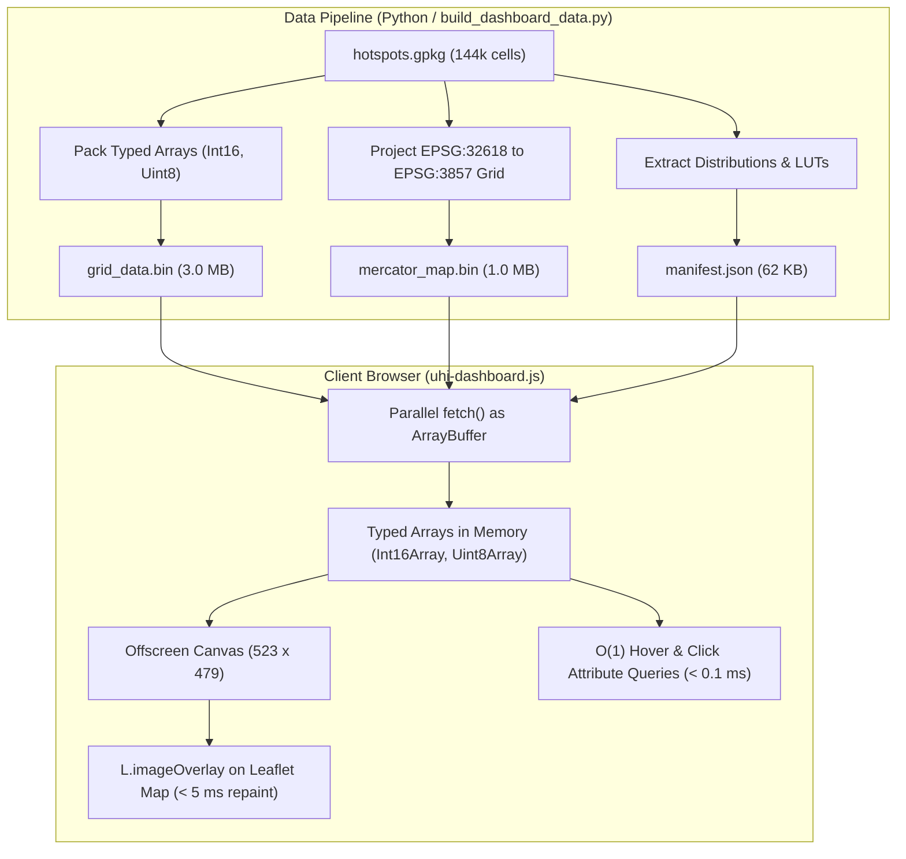

# NOVA Urban Heat Island Dashboard: Architecture, Libraries, and Data Formatting

This document details the software libraries, architectural choices, and binary data engineering behind the interactive Northern Virginia Urban Heat Island (UHI) mapping dashboard.

---

## 1. Libraries and Technical Stack

The dashboard is built to be **ultra-lightweight, zero-build, and serverless**. It runs entirely in the client's browser from static assets, requiring no Node.js backend, Python runtime, or database server.

| Technology / Library | Version / Source | Role & Purpose | Why It Was Chosen |
| :--- | :--- | :--- | :--- |
| **Leaflet.js** | `1.9.4` (CDN) | Interactive mapping engine | Lightweight (~42 KB gzip), battle-tested, high mobile touch performance, and seamless raster `ImageOverlay` support without the bloat of GIS heavyweights like OpenLayers or Cesium. |
| **OpenStreetMap Tiles** | Standard Tile Service | Basemap tiles | Completely open, reliable, free tile service requiring no private API tokens or rate-limiting credit cards. Styled via CSS filters to stay muted and accessible. |
| **Vanilla JavaScript** | Modern ES6+ | UI & analytical engine | Zero framework dependencies (no React, Vue, Angular, Vite, or Webpack). Eliminates bundle complexity, dependency rot, and build steps. |
| **HTML5 Canvas API** | Native Browser API | Offscreen raster rendering | Enables direct 32-bit pixel buffer manipulation (`ImageData.data`). Repaints all 250,000 Mercator pixels in **< 5 milliseconds**. |
| **Analytical Projection Engine** | Custom JS implementation | Coordinate conversions (WGS84 $\leftrightarrow$ UTM Zone 18N) | Replaced heavy projection libraries (like `proj4js`, 100+ KB) with exact Redfearn / Karney analytical formulas accurate to $< 0.1 \text{ mm}$. |
| **Figtree Typography** | Google Fonts | Visual styling | Adheres strictly to project visual guidelines (`GEMINI.md`). |

---

## 2. The Data Engineering Problem

The campaign data spans **144,438 grid cells** ($362 \text{ rows} \times 399 \text{ columns}$) at a fine $100\text{ m}$ spatial resolution across Northern Virginia.

### Why Standard Formats Fail for the Web:
- **GeoJSON**: A standard GeoJSON with 144k polygons and multiple attributes (temperatures, anomalies, canopy, persistence) exceeds **60–80 MB**. Browsers freeze parsing JSON strings of that scale, and Leaflet SVG/Canvas layer groups with 140k vector shapes cause catastrophic DOM memory crashes.
- **GeoTIFF (Cloud-Optimized GeoTIFF)**: Requires heavy client-side Decoders (e.g., `geotiff.js`, > 200 KB) and cannot easily pack discrete multi-temporal categorical attributes (persistence levels, anomalies, and canopy cover) in a single fast query structure.
- **Server-rendered Tile Cache (MBTiles/PNG)**: Requires maintaining an active tile server (e.g., GeoServer, Tegola, TileServer-GL) or storing tens of thousands of pre-rendered PNG tiles, making embedding or simple static GitHub hosting impractical.

---

## 3. High-Efficiency Binary Data Architecture

To solve this, the pipeline ([`build_dashboard_data.py`](../build_dashboard_data.py)) packages the entire campaign dataset into two compact binary typed array files and one metadata manifest totaling **~4 MB**:

```
web_dashboard/data/
├── manifest.json       ( 62 KB) - Metadata, bounds, statistics & color LUTs
├── mercator_map.bin    (1.0 MB) - Precomputed Web Mercator pixel lookup table
├── grid_data.bin       (3.0 MB) - Packed typed array storage for 144,438 cells
└── counties.geojson    ( 14 KB) - Simplified boundary lines for orientation
```



### 3.1. `grid_data.bin` Layout (3,033,198 bytes)

All 144,438 cells are stored in a contiguous, byte-aligned binary file. Every cell is indexed by its 1D row-major coordinate:
$$\text{index} = \text{row} \times 399 + \text{col}$$

| Layer / Attribute | Data Type | Byte Offset in File | Precision / Packing Factor | NoData Sentinel | Description |
| :--- | :--- | :--- | :--- | :--- | :--- |
| **`inside`** | `Uint8` | `0` | Flag (0 or 1) | `0` | Study region ROI mask |
| **`temp_am`** | `Int16` | `144,438` | Value $\times 10$ ($80.6^\circ\text{F} \rightarrow 806$) | `-32768` | Morning Air Temperature |
| **`temp_af`** | `Int16` | `433,314` | Value $\times 10$ ($95.3^\circ\text{F} \rightarrow 953$) | `-32768` | Afternoon Air Temperature |
| **`temp_pm`** | `Int16` | `722,190` | Value $\times 10$ ($93.1^\circ\text{F} \rightarrow 931$) | `-32768` | Evening Air Temperature |
| **`anom_am`** | `Int16` | `1,011,066` | Value $\times 100$ ($+1.85^\circ\text{F} \rightarrow 185$) | `-32768` | Morning Anomaly vs Mean |
| **`anom_af`** | `Int16` | `1,299,942` | Value $\times 100$ ($-2.10^\circ\text{F} \rightarrow -210$) | `-32768` | Afternoon Anomaly vs Mean |
| **`anom_pm`** | `Int16` | `1,588,818` | Value $\times 100$ ($+3.40^\circ\text{F} \rightarrow 340$) | `-32768` | Evening Anomaly vs Mean |
| **`canopy`** | `Uint8` | `1,877,694` | Integer % ($0 \text{ to } 100$) | `255` | Tree Canopy Cover % |
| **`spot_am`** | `Uint8` | `2,022,132` | Discrete ($0=\text{Not Sig}, 1=\text{Cold}, 2=\text{Hot}$) | `255` | Morning Spot Category |
| **`spot_af`** | `Uint8` | `2,166,570` | Discrete ($0=\text{Not Sig}, 1=\text{Cold}, 2=\text{Hot}$) | `255` | Afternoon Spot Category |
| **`spot_pm`** | `Uint8` | `2,311,008` | Discrete ($0=\text{Not Sig}, 1=\text{Cold}, 2=\text{Hot}$) | `255` | Evening Spot Category |
| **`pers`** | `Uint8` | `2,455,446` | Categorical integer ($0 \text{ to } 7$) | `255` | Multi-period Persistence |
| **`z_am/af/pm`**| `Int8` | `2,599,884+`| Z-score $\times 10$ (clamped $[-127, 127]$) | `-128` | Getis-Ord $G_i^*$ intensity |

### 3.2. `mercator_map.bin` Lookup Table (1,002,068 bytes)

Web maps (Leaflet, Google Maps, OpenStreetMap) use the **Web Mercator (EPSG:3857)** spherical projection, whereas the campaign grid is in **UTM Zone 18N (EPSG:32618)**.

Reprojecting 144k UTM cells to Web Mercator in JavaScript every time the layer changes would stutter and drain battery. Instead, `build_dashboard_data.py` precomputes an exact $523 \times 479$ Web Mercator pixel raster:
- For every pixel $(x, y)$ in the Web Mercator bounding box, it calculates the corresponding UTM coordinates and maps it to a single 1D grid cell index.
- If a pixel falls outside the NOVA campaign boundary, its value is `-1`.
- The client-side renderer simply loops over 250,517 integers:
  ```javascript
  const gIdx = mercatorMap[p];
  if (gIdx >= 0) {
    const tempVal = tempArray[gIdx] / 10.0;
    // Map value to RGB using Color LUT in O(1)
  }
  ```
- This yields instantaneous layer repainting in under **5 ms** on modern browsers.

### 3.3. `manifest.json`

Provides all constants needed to decode the binary data without hardcoded magic numbers:
1. **Grid layout**: Dimensions ($362 \times 399$), UTM bounding box `[284621.5, 4284453.5, 324521.5, 4320653.5]`, and cell size ($100\text{ m}$).
2. **Mercator overlay coordinates**: Exact WGS84 southwest and northeast latitudes/longitudes for Leaflet's `L.imageOverlay`.
3. **Distribution Statistics**: Precomputed 2nd and 98th percentiles ($p_2, p_{98}$) for robust thermal color stretching that avoids distortion from outlier sensor readings.
4. **Color Look-Up Tables (LUTs)**: 256-entry RGB tables for matplotlib colormaps (`YlOrRd`, `Spectral_r`, `YlGn`).
5. **Labels and discrete color palettes**: Hex/RGB codes for Hot Spots (`#E74C3C`), Cold Spots (`#2980B9`), and diurnal persistence categories.

---

## 4. Analytical Coordinate Conversions

To ensure interactive features (hover popovers, click inspection, and cell highlighting) operate with zero latency, the client code ([`uhi-dashboard.js`](js/uhi-dashboard.js)) implements exact ellipsoidal projection equations:

### 1. Forward Transform: WGS84 $\rightarrow$ UTM Zone 18N
When the user moves the mouse across the map at latitude $\phi$ and longitude $\lambda$:
1. Converts $(\phi, \lambda)$ to UTM $(X, Y)$ using Redfearn's Transverse Mercator formulation.
2. Derives cell indices via direct $O(1)$ arithmetic:
   $$\text{col} = \left\lfloor \frac{X - X_{\min}}{\text{cell\_size}} \right\rfloor, \quad \text{row} = \left\lfloor \frac{Y_{\max} - Y}{\text{cell\_size}} \right\rfloor$$
3. Queries `grid_data.bin` at $\text{row} \times 399 + \text{col}$ to update the hover popover in **$< 0.1 \text{ ms}$**.

### 2. Inverse Transform: UTM Zone 18N $\rightarrow$ WGS84
When the user clicks a cell:
1. Calculates the exact bounding UTM box for that cell:
   $$[X_0, Y_0, X_1, Y_1] = [X_{\min} + \text{col} \cdot 100, \, Y_{\max} - (\text{row}+1) \cdot 100, \, X_0 + 100, \, Y_0 + 100]$$
2. Inverts all 4 corners into $(\text{lat}, \text{lon})$ coordinates.
3. Renders a precise `L.polygon` highlight boundary over the clicked 100m grid cell.

---

## 5. Summary of Key Advantages

| Metric / Aspect | Standard Web GIS Approach | This Architecture |
| :--- | :--- | :--- |
| **Total Transfer Size** | 60–100 MB (GeoJSON / Shapefiles) | **~4.0 MB total** (3 MB data + 1 MB map) |
| **Build System** | Node.js, Webpack, npm dependencies | **Zero-build** (Vanilla JS, HTML5, CSS) |
| **Initial Map Load Time** | 5–15 seconds | **< 400 milliseconds** |
| **Layer Switch Latency** | Network tile request round-trip (200–800 ms) | **< 5 milliseconds** (in-memory canvas) |
| **External API Keys** | Mapbox/Google token required | **None** (OpenStreetMap & local vectors) |
| **Hosting Requirements** | Tile server / dynamic container / GeoServer | **Any static host** (GitHub Pages, S3, Netlify, cPanel) |

